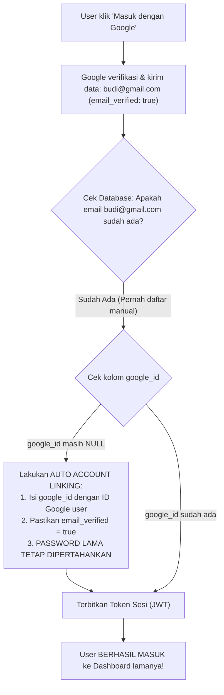

# Rancangan Alur Pendaftaran & Masuk (Auth Architecture & Account Linking)

Dokumen ini merangkum rancangan alur autentikasi pengguna (Registrasi & Login) untuk WAPromo, mencakup integrasi Google OAuth, pendaftaran manual Email + Password, dan metode **Penautan Akun Otomatis (*Auto Account Linking*)**.

---

## 1. Skema Kolom Database (`users`)

Agar sistem mendukung fleksibilitas kedua metode autentikasi secara mulus (*dual-login*), kolom tabel pengguna dirancang sebagai berikut:

| Kolom | Tipe Data | Keterangan |
| :--- | :--- | :--- |
| `id` | `UUID` / `VARCHAR` | Primary Key unik pengguna |
| `email` | `VARCHAR UNIQUE` | Email pengguna (identitas primer sistem) |
| `name` | `VARCHAR` | Nama lengkap pengguna |
| `business_name` | `VARCHAR` | Nama bisnis/usaha (wajib diisi saat onboarding) |
| `phone_number` | `VARCHAR` | Nomor WhatsApp standar E.164 (tanpa `+`, tanpa spasi, cth: `628123456789`) |
| `password_hash` | `VARCHAR NULL` | Hash password (BCrypt/Argon2). Bernilai `NULL` jika daftar via Google |
| `google_id` | `VARCHAR UNIQUE NULL` | Identifier unik dari Google (`sub` token OAuth) |
| `email_verified` | `BOOLEAN DEFAULT FALSE` | Otomatis `TRUE` jika berasal dari Google OAuth |
| `auth_provider` | `VARCHAR` | `'google'`, `'credentials'`, atau `'hybrid'` |
| `created_at` / `updated_at` | `TIMESTAMP` | Waktu pembuatan & pembaruan data |

---

## 2. Skenario 1: Pendaftaran Pertama Kali Menggunakan Google

### Alur UX & Logika:
1. **User klik tombol "Daftar dengan Google"** di halaman registrasi.
2. Google OAuth memproses izin dan mengembalikan payload identitas terverifikasi:
   * `email`: misal `budi@gmail.com`
   * `name`: misal `Budi Santoso`
   * `sub` (Google ID): misal `109283910283...`
   * `email_verified`: `true`
3. **Backend memeriksa ketersediaan email:**
   * Jika email **belum ada** di database, simpan data awal dengan `password_hash = NULL`.
4. **Halaman Onboarding ("Lengkapi Profil"):**
   * Pengguna diarahkan ke form singkat untuk melengkapi data yang belum ada:
     * **Nama & Email**: Ditampilkan otomatis (*prefilled/read-only* dari Google).
     * **Nama Bisnis**: Wajib diisi.
     * **Nomor WhatsApp**: Wajib diisi (menggunakan *country selector* & sanitasi otomatis E.164).
     * **Kolom Password**: **TIDAK DITAMPILKAN** agar pendaftaran cepat dan tanpa hambatan (*frictionless*).
5. User menekan tombol "Mulai" $\rightarrow$ langsung masuk ke Dashboard.

### Alur Login Selanjutnya (Skenario 1):
* User cukup menekan tombol **"Masuk dengan Google"** di halaman login.
* Backend mencocokkan `google_id` atau `email` $\rightarrow$ langsung terbitkan token sesi/JWT $\rightarrow$ masuk Dashboard (1 klik tanpa password).

---

## 3. Skenario 2: Daftar Manual (Email + Password) $\rightarrow$ Lalu Login Pakai Google

### Permasalahan:
Pengguna awalnya mendaftar manual menggunakan email `budi@gmail.com` dan membuat password. Suatu hari pengguna lupa, lalu menekan tombol **"Masuk dengan Google"** menggunakan akun `budi@gmail.com`.

### Solusi (*Auto Account Linking*):
Sistem **TIDAK BOLEH menolak** dan **TIDAK BOLEH membuat akun duplikat**. Akun lama harus otomatis ditautkan secara aman.

### Hasil Akhir untuk Pengguna:
* **Dual-Login Aktif**: Pengguna kini bebas memilih cara masuk kapan saja:
  1. Masuk via **Email + Password** (tetap bisa karena password lamanya tidak dihapus).
  2. Masuk via **Google** (bisa karena `google_id` sudah tertaut).
* Data bisnis, nomor WhatsApp, kontak, dan riwayat yang pernah dibuat tidak ada yang hilang.

---

## 4. Skenario 3: User Baru (Belum Terdaftar) Langsung Klik "Masuk dengan Google" di Halaman Login

### Permasalahan:
Pengguna baru pertama kali berkunjung ke WAPromo, belum pernah mendaftar (baik via form manual maupun Google). Pengguna langsung membuka halaman `/login` dan mengklik tombol **"Masuk dengan Google"**.

### Perilaku Sistem (Universal Google Auth Gateway):
* **Jika login manual (Email + Password)**: Sistem menolak dengan error *"Email atau password salah / belum terdaftar"* karena kredensialnya tidak dikenali.
* **Jika via Google**: Sistem **TIDAK BOLEH menolak** dan tidak boleh menyuruh user pindah ke halaman register. Mengapa? Karena jika disuruh ke halaman register, user hanya akan mengklik tombol Google yang sama persis.

### Alur Kerja:
1. Google memverifikasi pengguna dan mengirimkan data: `email`, `name`, `sub`, `email_verified: true`.
2. Backend mengecek: email belum terdaftar di database.
3. Backend otomatis memperlakukan ini sebagai **Pendaftaran Baru**:
   * Buat record akun baru dengan `password_hash = NULL` dan `google_id` terisi.
   * Alihkan (*redirect*) user langsung ke **Halaman Onboarding ("Lengkapi Profil")** untuk mengisi `Nama Bisnis` dan `Nomor WhatsApp`.
4. Setelah user mengisi form onboarding $\rightarrow$ diarahkan masuk ke Dashboard.

> **Prinsip Utama:** Bagi Google OAuth, tombol *"Daftar dengan Google"* di halaman Register dan *"Masuk dengan Google"* di halaman Login menggunakan gerbang backend yang sama:
> - **Email sudah ada?** $\rightarrow$ Langsung Login ke Dashboard.
> - **Email belum ada?** $\rightarrow$ Auto-Register $\rightarrow$ Buka form Onboarding (Nama Bisnis & Nomor WhatsApp) $\rightarrow$ Masuk Dashboard.

---

## 5. Skenario 4: User Google Ingin Menambahkan Password Nanti

Jika pengguna yang awalnya hanya login via Google ingin memiliki password (misalnya agar akun bisnisnya bisa digunakan login oleh admin/staf tanpa memberikan akses Gmail pribadi):

1. Masuk ke **Pengaturan Akun $\rightarrow$ Keamanan $\rightarrow$ "Buat Password Akun"**.
2. Karena pengguna login via Google, sistem mengizinkan pembuatan password baru tanpa meminta "password lama".
3. Nilai hash disimpan ke kolom `password_hash`.
4. Pengguna kini memiliki kemampuan *Dual-Login* (Google + Password).
5. Atau pengguna dapat menggunakan alur **"Lupa Password"** di halaman login untuk mengatur password baru via link konfirmasi email.

---

## 6. Ringkasan Prinsip Keamanan & UX

1. **Postel's Law untuk Nomor WhatsApp**: Validasi dan sanitasi nomor WhatsApp di sisi backend ke format standar E.164 murni (hanya digit, tanpa `+`, tanpa strip, tanpa spasi).
2. **Kebenaran Mutlak dari Google (`email_verified: true`)**: Auto-linking hanya boleh dijalankan jika Google secara eksplisit mengirimkan atribut `email_verified: true`.
3. **Pemberitahuan Keamanan (Opsional)**: Saat terjadi penautan akun otomatis untuk pertama kali, sistem dapat mengirimkan email notifikasi santun: *"Akun Google Anda baru saja ditautkan ke akun WAPromo."*
